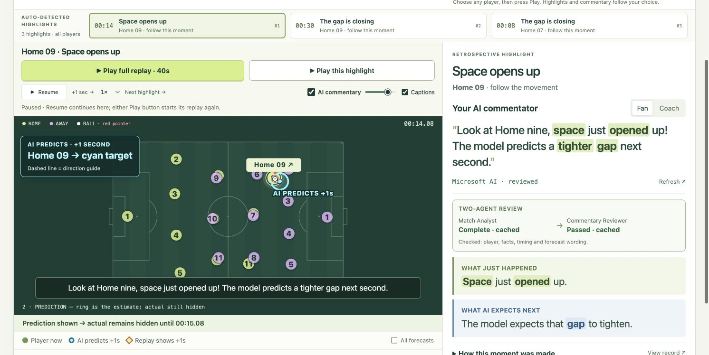

# THE MATCH LAB

**Discover the moment. See what may happen next. Hear the story.**

THE MATCH LAB is a browser-based football commentary and analysis prototype for fans and coaches. It finds changes in player spacing, turns them into short highlights, and combines continuous replay, player annotations, a next-second position forecast, and synchronized AI-generated speech.

**[Open the live demo](https://nextsecond-football-27oct26.azurewebsites.net/)** · [Run locally](RUNNING.md) · [Project pitch](PROJECT_PITCH.md) · [Validation](VALIDATION.md)

**Current public release: 1.6.0**, with Fan/Coach views and visible Analyst/Reviewer status.

## Try the product

No account is needed for the hosted demo.

1. Choose **Find Space**, **Defensive Shift**, or **Transition**. Each is a different 40-second synthetic scene.
2. Leave **AI commentary** and **Captions** enabled. Press **Play full replay · 40s** to watch the whole scene. Prepared commentary plays at qualifying highlights; the intervals between them can be silent.
3. For a closer look, select a highlight card and press **Play this highlight**. The clip includes a short build-up before the event and continues afterwards. Speech begins at the event, after the build-up.
4. Use **My Focus** to follow any of the 22 players. Home 09 and Home 07 are example shortcuts. Following a player changes the selected highlights, pitch emphasis, evidence and commentary. Some players have no qualifying highlight.
5. Switch between **Fan** and **Coach**. Fan keeps the commentary visual and intuitive; Coach exposes distances, errors and numerical evidence. In Coach mode, open **Try Your Own Prediction** to choose a time and player for manual inspection.

The forecast ring shows a player's estimated position one second ahead. The recorded-position diamond appears when the replay reaches that time. Normal replay continues through this comparison. Pause, resume, seeking, volume and caption controls remain available.

## The problem we address

Football movement can be difficult to interpret from a pitch full of dots or a table of statistics. Viewers need to know where to look, why a change matters, and what might happen next. THE MATCH LAB places that explanation beside the moving players and lets each viewer choose whom to follow.

For example, a player may have just gained space while the model expects that gap to narrow next. The interface separates **what just happened**, **what was measured at the highlight**, and **what the model expects next**, so these statements remain understandable together.

## How it works

| Stage | Implemented behavior |
| --- | --- |
| Find moments | Scan the replay retrospectively for changes in nearest-opponent distance and player displacement. Rank up to three qualifying highlights for the selected focus. |
| Predict movement | A frozen PyTorch ST-GNN + TCN uses past tracking observations to predict the 22 players' positions one second ahead. Future recorded positions are excluded from inference. |
| Analyze and review | A Match Analyst Agent selects computed facts. A separate Commentary Reviewer Agent invocation checks the rendered analysis and proposed script against the evidence. Both roles use Azure-hosted GPT-5-mini with different prompts and validated outputs. |
| Speak the moment | Azure OpenAI TTS, using the built-in Alloy voice, reads a short script derived from validated evidence. The deployed clips are prepared and cached, then played in sync with the replay and captions. |
| Personalize | My Focus changes the subject and eligible highlights. Fan and Coach independently control explanation depth. |

Highlight selection is a retrospective geometric scan, not a goal detector. At each candidate, it examines the previous second. The score is absolute gap change plus 0.35 times displacement; candidates need at least 0.5 metres of gap change or 1.5 metres of displacement. Goalkeepers are excluded and selected moments are spaced at least six seconds apart. The score is a ranking heuristic, not confidence or scoring probability.

## Microsoft and Azure technology

The public application runs on **Azure App Service** with FastAPI and a CPU PyTorch predictor. **Microsoft Foundry / Azure OpenAI** supplies GPT-5-mini for constrained evidence selection and TTS for the deployed commentary. The frontend uses HTML, CSS, JavaScript and SVG.

A lightweight harness coordinates two model roles in a fixed sequence, with validation, caching and fallback. Credentials stay on the server. Bounded requests and timeouts protect the public endpoints. Missing cloud text falls back to a clearly labelled local geometry summary; unavailable speech leaves the replay and captions usable. Ordinary playback does not wait for generation or call a language model on every frame.

## Two Agent collaboration

**Match Analyst → Commentary Reviewer** is a real two-call workflow. The Analyst selects and orders known fact IDs. The server renders the facts, then the Reviewer independently checks the player, numeric claims, past-versus-future timing and whether a forecast is labelled as an estimate. Both calls use the same Azure text deployment; the roles have separate instructions and responsibilities.

The lightweight harness in `demo/reviewed_insights.py` coordinates the handoff, validates structured responses, shares the existing request allowance, bounds review time, caches successful reviews and emits a run record. The interface shows each role's result, distinguishing complete, passed, cached, unavailable, flagged and not-run states. **How this moment was made** exposes the steps and trace for inspection. This is a fixed workflow, with no autonomous tool selection or open-ended agent loop.

A failed or unavailable review leaves local evidence usable and is never labelled a successful two-Agent run. Reviewer status concerns the proposed script; it is not a transcript of the synthesized sound. Existing prepared speech can play from cache without a fresh review, so playback does not wait for these calls. See [the execution and configuration guide](ARCHITECTURE.md), [real Azure proof records](docs/two-agent-proof.json) and the nine focused cases in `demo/test_reviewed_insights.py`.

## Data and scope

The three demo scenes are original procedural trajectories from `demo/synthetic.py`, showing 22 players and a ball at 25 Hz. They are not footage or tracking excerpts from actual matches. Automatic highlight discovery can inspect the full replay, while the position predictor receives only observations available at its prediction time.

The frozen movement model was trained separately on prepared windows from three [Metrica Sports sample matches](https://github.com/metrica-sports/sample-data). That training data is distinct from the synthetic demo. The repository package includes the model architecture and inference code; it excludes the training data and trained checkpoint. Full local inference therefore requires the compatible checkpoint described in [RUNNING.md](RUNNING.md). The hosted demo already has it installed.

Speech is **pre-generated AI commentary**, not live voice generation. The current release uses English and a generic built-in voice. Nearest-opponent distance alone does not establish a safe pass, possession, offside or a scoring chance. On-screen synthetic replay errors are not evidence of real-match prediction accuracy.

## Run and configure

Clone [this repository](https://github.com/ln-lai/the-match-lab) and follow [RUNNING.md](RUNNING.md). Python 3.12 and the dependencies in `demo/requirements-dev.txt` are used. Full local inference needs the exact checkpoint specified there; source review and the mocked Agent tests work without it. No frontend build is required.

Both Agent roles share `AZURE_OPENAI_ENDPOINT`, `AZURE_OPENAI_API_KEY` and `AZURE_OPENAI_DEPLOYMENT`. TTS uses `AZURE_TTS_DEPLOYMENT`. `.env.example` contains placeholders only; configuration is read from process environment variables. No Azure subscription, secret, training data or private checkpoint is published in this repository.

## Repository contents

| Location | Purpose |
| --- | --- |
| `demo/web/` | Replay interface, SVG pitch, captions and audio scheduling |
| `demo/backend.py` | Replay, highlight, prediction and evidence API |
| `demo/synthetic.py` | Independent synthetic scene generation |
| `demo/azure_insights.py` | Analyst fact selection, evidence rendering and fallback |
| `demo/reviewed_insights.py` | Independent Reviewer invocation and lightweight handoff harness |
| `demo/commentary.py` | Evidence-derived scripts, speech integration and cache |
| `model.py`, `predict.py` | Trained model architecture and inference interface |
| `demo/test_*.py` | Backend and mocked service regression tests |
| `.env.example`, `RUNNING.md` | Configuration placeholders and exact run instructions |

See [VALIDATION.md](VALIDATION.md) for the checks completed on the current release. See [LICENSE-NOTICE.md](LICENSE-NOTICE.md) for source and data provenance; this source package does not assign a new license or include private deployment files.
